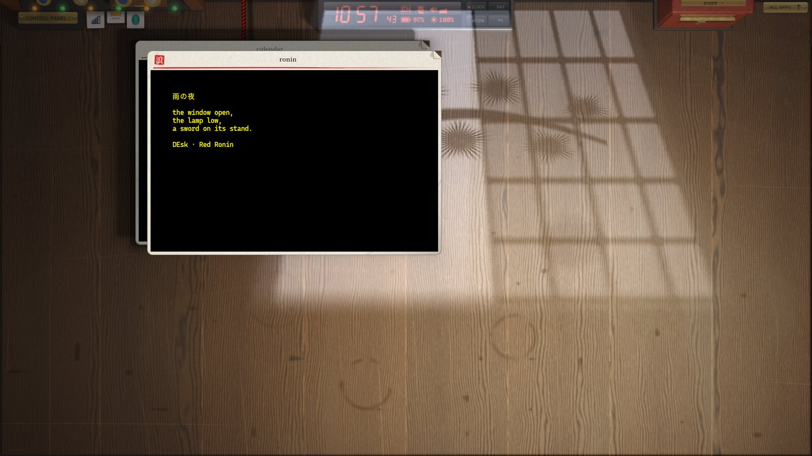
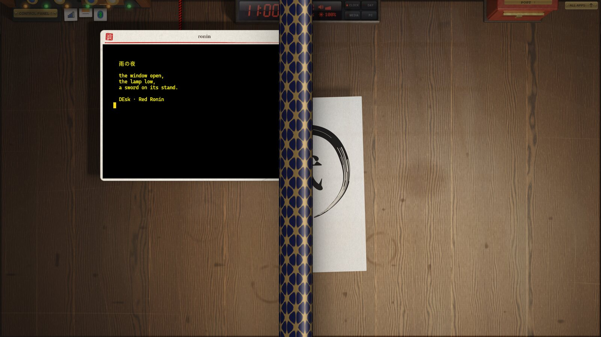
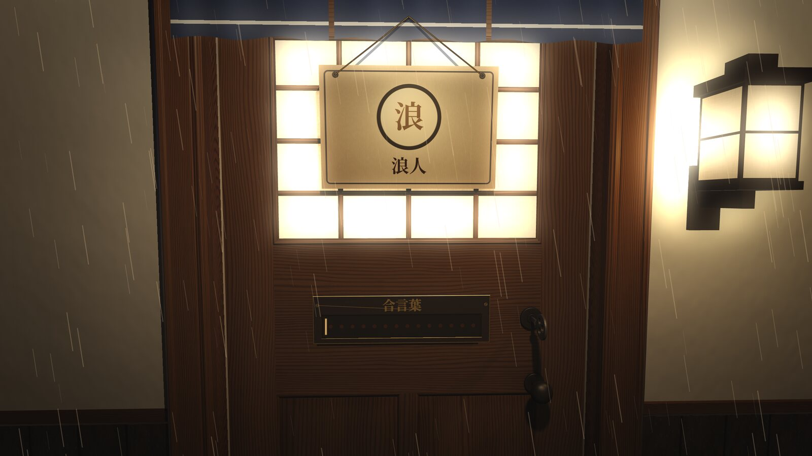
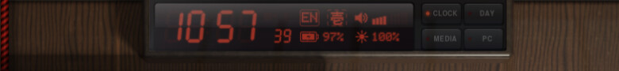
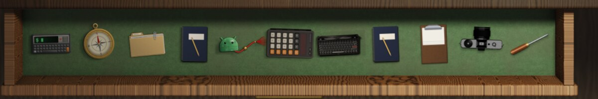
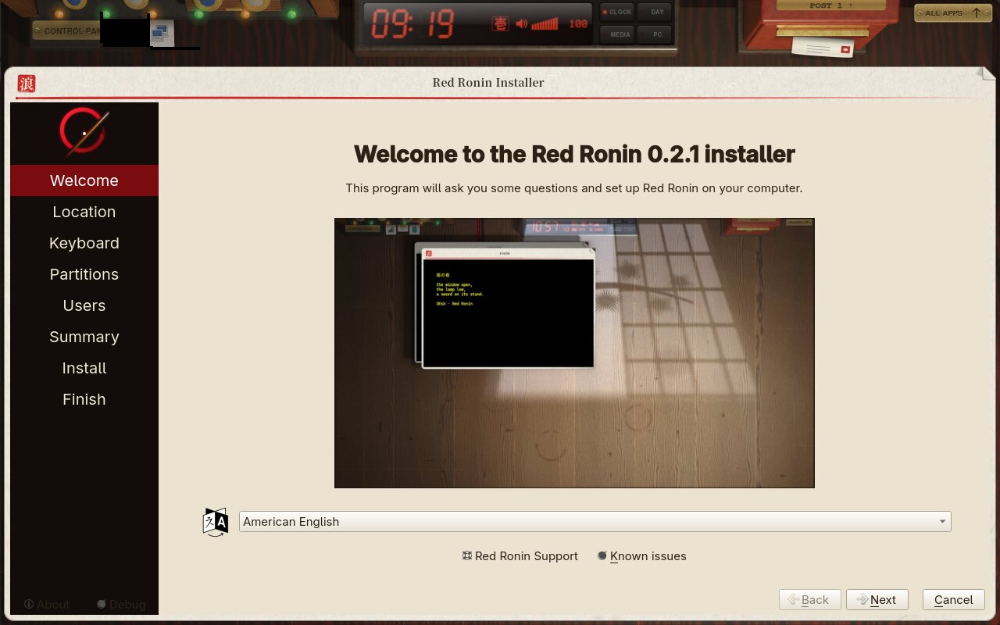

# DEsk · Red Ronin

A fork of [DEsk](https://github.com/fyzugx/DEsk) by fyzugx, the skeuomorphic Wayland
desktop. It is reworked into a quiet Japanese study at night: the room of a masterless
samurai (*rōnin*), with Hyprland's keys, tiling and per-screen workspaces. DEsk's own
design and nearly all of its code are fyzugx's. This fork changes and adds to it,
and keeps it under the same MIT license.



## AI disclosure

**This fork was written with AI.** Its changes were made by **Claude** (Anthropic's model,
in Claude Code), directed by the fork's maintainer:
- the maintainer said what was wanted and what was wrong, after using the desk day to day;
- the model wrote the code, tested it, and installed it on the maintainer's machine.

Each round of changes was checked before it was installed:
- reviewed by a separate AI agent that had not written it; the bugs it found were fixed;
- built and tested in Docker, with headless end-to-end checks driven through `desk-ctl` and
  the unit tests;
- where a test DEsk could run, its look was checked from screenshots.

Nothing here has had a human code review line by line. Read it as you would any code an AI
wrote: it works on the machine it was made on (Arch Linux, an NVIDIA RTX A5000 laptop, two
or three screens), and it has been tested, but it has not been proven everywhere.

## What was changed, and why

### Moving and tiling windows like Hyprland
- **Tiling:** master, dwindle, columns and monocle layouts, gaps and ratios (`src/tile.c`).
  *Why:* DEsk only floats windows, and the maintainer comes from Hyprland.
- **Keys:** Hyprland's keys for focus, move, swap, resize, split and workspaces, plus a lone
  Super tap for the launcher. Your own binds go in `shell.conf`. *Why:* to keep the
  maintainer's muscle memory.
- **Per-screen workspaces:** each screen shows its own workspace. Super+N goes to the screen
  already showing N, or brings N to this one; `workspace_screen` binds a workspace to a
  screen. *Why:* switching on one screen used to change every screen.
- **Moving between screens:** Super+Alt+arrows jumps to the next screen, and
  Super+Ctrl+Shift+arrows sends a window there. *Why:* to get around three screens by
  keyboard.
- **Focus follows the mouse** (`focus_follows_mouse`): the window you move into gets the
  keys, without a click and without being raised. Menus and popups are left alone. *Why:*
  as in Hyprland.
- **Layer-shell:** bars and launchers such as fuzzel and waybar. *Why:* so the usual
  Wayland tools work.

### Smoothness and the machine
- **Window glides:** a window's frame and shadow are stretched while it glides, and redrawn
  once where it lands. Over a test run, dropped frames went from 25 to 2. *Why:* the frame was
  repainted on the CPU every frame of every glide.
- **The room's backgrounds:** they are drawn at low GPU priority, and in smaller pieces once
  the desk is up. *Why:* for the first minute after login the desk was dropping frames.
- **Swift motion** (`motion = swift`) and less bounce. *Why:* the animations felt slow.
- **Explicit sync:** `packaging/redronin/wlroots-0.18.3-explicit-sync.patch` makes wlroots 0.18
  wait for a client's finished frame, and release buffers behind a GPU fence; DEsk then
  offers `linux-drm-syncobj-v1`. *Why:* on NVIDIA there is no implicit sync, and Chromium
  flickered and showed stale pages.
- **Plugged in** (`screen_off_plugged`, default never): the screen doesn't dim or lock while on
  the mains.
- **Measuring tools:** a frame profiler you can switch on per login (`~/.config/desk/environment`),
  per-tick timings (`DESK_PROFILE_TICKS`), and `desk-ctl do pointer X Y` for tests. *Why:* to
  measure smoothness rather than guess.

### The Japanese / ronin look
- **The calligrapher's desk:** a *shitajiki* writing mat, washi headings with a brushed rule, a
  red *hanko* seal on the window with the keys, workspaces counted in *daiji* (壱 弐 参), a
  negoro-lacquer desk, and an empty workspace showing an ensō on a practice sheet.
  
- **Workspace changes in 3D** on the GPU (`src/wstrans.c`): the emakimono scroll (the default),
  plus katana, byōbu and shoji. *Why:* switching was an instant cut.
- **The night and the storm** (`src/storm.c`):
  - the desk at night, with a shoji window's light across it;
  - lightning that differs every time: near or far, here or there in the sky, with a pine
    branch and the lattice in its shadows;
  - a cord that opens the window: rain is heard, its streaks run through the light, and drops
    blow in and splash.
  - Rain and thunder are only heard with the window open, and both are made in code, not
    recordings.
- **The lock screen:** a dojo's gate instead of a front door. Plaster and charred cedar, a
  lattice sliding door with shoji (it slides into the wall), a noren with a mitsudomoe, the
  password on black lacquer (合言葉), an andon lantern, and a hinoki name board.
  
- **The login screen:** the SDDM theme `red-ronin-dojo` is the same gate (`scripts/redronin-greeter.sh`
  draws it with your name), with the password typed into the lacquer board.
- **The clock** shows the keyboard layout (EN / ع …) when you have two.
  
- **The drawer:** a look for Android Studio, a jade netsuke (`art/looks/android_netsuke.py`).
  

### Small things
- **Super+Escape** opens a power menu (`desk-power-menu`) instead of logging out at once.
  Super+Shift+Escape still logs out.
- **The login screen's session list** shows the session you chose. *Why:* the old theme always
  said "Hyprland".
- **`desk-session`** reads `~/.config/desk/environment`, and a mistake in that file can't stop
  you from logging in.

## Installing

### The ISO: a whole system

The release has an ISO, `redronin-*.iso`, built on Arch Linux's own install medium:
- It boots into a live DEsk Red Ronin, logged in as `ronin` with no password.
- **Install Red Ronin** in the drawer runs the **Calamares** installer. It asks for your
  language, keyboard and disk, and the user to make. Then it copies the live system to the
  disk, installs GRUB for UEFI, and removes the live-only pieces.



Write it to a USB stick (`sudo dd if=redronin-*.iso of=/dev/sdX bs=4M status=progress`, or
Ventoy, Balena Etcher, Rufus) and boot from it. It's made by `packaging/redronin/iso/build-iso.sh`
from `packaging/redronin/arch/PKGBUILD` and the AUR's `calamares`.

**Tested in a QEMU virtual machine (UEFI, a blank 30 GB disk):**
1. It boots to the live desk.
2. The installer opens from the drawer.
3. It erases the disk and installs; this needed one fix, now in the ISO.
4. The installed system boots through GRUB to the dojo's gate.
5. Logging in reaches the desk.

**Not tested:** real hardware, NVIDIA's proprietary driver (the ISO uses the open drivers),
BIOS (non-UEFI) installs, and installs next to another system. A virtual machine has no 3D,
so DEsk draws in 2D there: no storm, no 3D workspace changes.

### On an Arch Linux you already have

From the release (or a clone of the `redronin` branch):

```sh
tar xf DEsk-redronin-*.tar.gz && cd DEsk-redronin-*
./scripts/install_redronin.sh          # DEsk, its wlroots, Red Ronin's settings
./scripts/install_redronin.sh --sddm   # ... and the dojo's gate as the login screen
```

Then log out and pick **DEsk**. It installs to `/usr/local`, with wlroots 0.18 in
`/opt/desk-wlroots`. Your own `~/.config/desk` files are never overwritten.

This was tested by unpacking the release tarball on a fresh Arch Linux container and running
`install_redronin.sh --no-apps --yes`. DEsk, the patched wlroots, the power menu, the login entry
and the settings were all installed, and `desk --version` ran.

Other distributions: DEsk's own `scripts/install_session.sh` and the Debian and Nix packaging are
untouched, but the Red Ronin additions are only tested on Arch.

## Known gaps

- Explicit sync needs the patched wlroots built by the installer. With a wlroots 0.18 from the
  AUR or another repository, DEsk simply does not offer it.
- The storm is not drawn on a rotated screen. The 3D workspace changes run sideways on a
  portrait screen.
- Behind the lock screen's door you still walk into DEsk's Western study, not a dojo.
- DEsk's CPU use while apps are redrawing constantly is higher than it should be, and is
  being measured.

## Credits

DEsk: fyzugx and the DEsk authors (MIT). Red Ronin: AhmedZaeem, with Claude (Anthropic).
